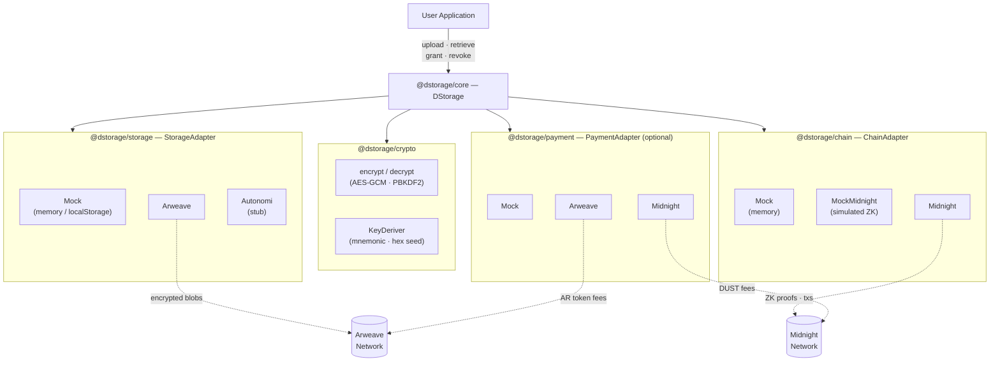
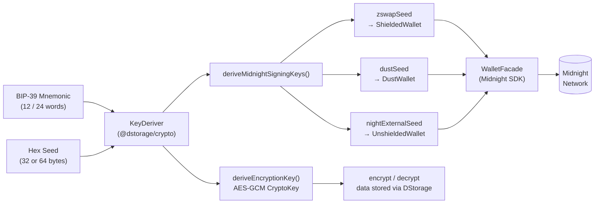
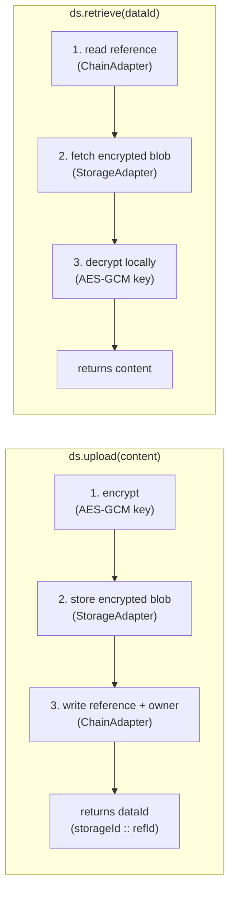

# Getting Started with dStorage SDK

dStorage is a modular SDK for building privacy-first decentralised applications. It handles client-side encryption, decentralised storage, and on-chain coordination through a simple, swappable adapter system.

Everything is imported from a single package: `@dstorage/core`.

---

## SDK Architecture



Each adapter slot is independently swappable. Swap `MockStorageAdapter` for `ArweaveStorageAdapter`, or `MockChainAdapter` for `MidnightChainAdapter`, without touching your application logic.

---

## Installation

```bash
npm install @dstorage/core
```

> Sub-packages (`@dstorage/crypto`, `@dstorage/storage`, `@dstorage/chain`, `@dstorage/payment`) are re-exported from `@dstorage/core` — you do not need to install them separately unless you want to use them in isolation.

---

## Initializing the SDK

`DStorage` is the main class. It takes three adapter slots:

```typescript
import { DStorage } from '@dstorage/core';

const ds = new DStorage({
  storageAdapter: ...,          // required — where encrypted data is stored
  chainAdapter:   ...,          // required — where on-chain references are written
  storagePaymentAdapter: ...,   // optional — how storage fees are paid (defaults to mock)
  chainPaymentAdapter:   ...,   // optional — how chain fees are paid (defaults to mock)
});
```

Pick the adapters that match your target environment. During development, start with all-mock adapters — no network, no tokens, no wallet extension required.

---

## Storage Adapters

Storage adapters define where encrypted blobs are stored.

### `MockStorageAdapter` ✅ Live

Stores data in `localStorage` (browser) or an in-memory `Map` (Node.js). No network calls. Perfect for development and unit tests.

```typescript
import { MockStorageAdapter } from "@dstorage/core";

const ds = new DStorage({
  storageAdapter: new MockStorageAdapter(),
  // ...
});
```

### `ArweaveStorageAdapter` ✅ Live

Uploads encrypted blobs to [Arweave](https://arweave.org) — pay once, store forever. Requires the `arweave` package and either ArConnect (browser) or a JWK wallet key (Node.js).

```typescript
import { ArweaveStorageAdapter } from "@dstorage/core";

// Browser — ArConnect wallet handles signing automatically
const ds = new DStorage({
  storageAdapter: new ArweaveStorageAdapter(),
  // ...
});

// Node.js — pass a JWK wallet key
import fs from "fs";
const ds = new DStorage({
  storageAdapter: new ArweaveStorageAdapter({
    walletKey: JSON.parse(fs.readFileSync("wallet.json", "utf8")),
  }),
  // ...
});

// Testnet (default is mainnet arweave.net)
const ds = new DStorage({
  storageAdapter: new ArweaveStorageAdapter({
    gateway: { host: "arweave.dev", port: 443, protocol: "https" },
  }),
  // ...
});

// Advanced options
const ds = new DStorage({
  storageAdapter: new ArweaveStorageAdapter({
    walletKey,
    maxRetries: 3, // retry failed posts up to N times (default: 3)
    waitForConfirmation: false, // block until tx is mined — can take 2–20 min (default: false)
    confirmationPollMs: 30_000, // how often to poll when waiting (default: 30 s)
  }),
  // ...
});
```

#### Setting up for Arweave

Before you can use `ArweaveStorageAdapter` with a real network you need a wallet with AR tokens and, for browser use, the ArConnect extension. Here is everything you need step by step.

---

**Step 1 — Install the `arweave` peer dependency**

`arweave` is an optional peer dependency. Install it alongside `@dstorage/core`:

```bash
npm install arweave
```

If you skip this step, the adapter will throw a clear error at runtime with the install command as a reminder.

---

**Step 2 — Get a wallet**

You need an Arweave wallet to sign and pay for transactions. Choose the path that matches your environment.

**Browser — ArConnect extension**

[ArConnect](https://www.arconnect.io) is the standard Arweave browser wallet, equivalent to MetaMask for Ethereum. It injects `window.arweaveWallet` which the adapter detects automatically.

1. Install from the [Chrome Web Store](https://chrome.google.com/webstore/detail/arconnect/einnioafmpimabjcddiinlhmijaionap) (Chrome / Brave / Edge) or [Firefox Add-ons](https://addons.mozilla.org/en-US/firefox/addon/arconnect/).
2. Open the extension and create a new wallet. ArConnect generates and stores your key securely — you never handle the raw key file in the browser.
3. Your dApp must call `window.arweaveWallet.connect()` before the first upload to request the necessary permissions. The adapter handles this transparently, but if you want to prompt the user explicitly at startup:

```typescript
// Request permissions up front (recommended for better UX)
await window.arweaveWallet.connect(
  ["ACCESS_ADDRESS", "SIGN_TRANSACTION", "DISPATCH"],
  { name: "Your App Name", logo: "https://yourapp.com/logo.png" },
);
```

> **Testnet tip:** In ArConnect, go to **Settings → Networks** and switch to `arweave.dev` while developing. This keeps test transactions completely separate from mainnet.

---

**Node.js — JWK wallet file**

For server-side scripts or backend services, use a JWK (JSON Web Key) wallet file.

_Option A — Generate a fresh wallet using arweave-js:_

```typescript
import Arweave from "arweave";
import fs from "fs";

const arweave = Arweave.init({
  host: "arweave.net",
  port: 443,
  protocol: "https",
});
const jwk = await arweave.wallets.generate();

fs.writeFileSync("wallet.json", JSON.stringify(jwk, null, 2));
console.log("Wallet address:", await arweave.wallets.jwkToAddress(jwk));
```

_Option B — Export from ArConnect:_ Open ArConnect → **Settings → Wallets → ⋮ → Export** → save the JSON file.

Pass the loaded JWK to the adapter:

```typescript
import fs from "fs";
import { ArweaveStorageAdapter } from "@dstorage/core";

const walletKey = JSON.parse(fs.readFileSync("wallet.json", "utf8"));
const adapter = new ArweaveStorageAdapter({ walletKey });
```

> ⚠️ **Never commit `wallet.json` to version control.** Add it to `.gitignore` immediately:
>
> ```
> echo "wallet.json" >> .gitignore
> ```

---

**Step 3 — Fund your wallet with AR tokens**

Arweave transactions require AR tokens to pay for permanent storage. The cost is tiny — typically fractions of a cent per KB — but the wallet must have a non-zero balance.

| Environment                 | How to get AR                                                                                                        |
| --------------------------- | -------------------------------------------------------------------------------------------------------------------- |
| **Testnet** (`arweave.dev`) | Use the free [Arweave faucet](https://faucet.arweave.net) — paste your wallet address and receive test AR instantly. |
| **Mainnet** (`arweave.net`) | Buy AR on a centralised exchange (Binance, Coinbase, KuCoin) or a DEX, then withdraw to your wallet address.         |

Check your balance before uploading:

```typescript
import Arweave from "arweave";
import fs from "fs";

const arweave = Arweave.init({
  host: "arweave.net",
  port: 443,
  protocol: "https",
});
const jwk = JSON.parse(fs.readFileSync("wallet.json", "utf8"));
const address = await arweave.wallets.jwkToAddress(jwk);
const winstons = await arweave.wallets.getBalance(address);

console.log(`Address: ${address}`);
console.log(`Balance: ${arweave.ar.winstonToAr(winstons)} AR`);
```

---

**Step 4 — Estimate cost before uploading**

`ArweaveStorageAdapter` fetches the current network fee from Arweave's oracle before every upload and includes it in the `UploadResult.cost` field. You can also estimate without committing:

```typescript
import {
  DStorage,
  ArweaveStorageAdapter,
  MockChainAdapter,
} from "@dstorage/core";

const ds = new DStorage({
  storageAdapter: new ArweaveStorageAdapter({ walletKey }),
  chainAdapter: new MockChainAdapter(),
});

await ds.connect(walletInfo);

// Returns a human-readable string, e.g. "~0.00000312 AR"
const estimate = await ds.estimateCost("My private content");
console.log(`Estimated storage cost: ${estimate}`);
```

---

**Step 5 — Switch from mock to Arweave (one-line change)**

The adapter pattern means swapping from development to production is a single line change:

```typescript
// Development — no network, no tokens needed
storageAdapter: new MockStorageAdapter();

// Production — drop-in replacement, zero application code changes
storageAdapter: new ArweaveStorageAdapter({ walletKey });
```

---

**Transaction lifecycle**

Arweave transactions are **optimistic** — a `202 Accepted` response means the gateway received the transaction, not that it is confirmed on-chain. Confirmation (block inclusion) typically takes **2–20 minutes**.

By default `ArweaveStorageAdapter` returns immediately after the gateway accepts the transaction. Set `waitForConfirmation: true` to block until the block height is available:

```typescript
const adapter = new ArweaveStorageAdapter({
  walletKey,
  waitForConfirmation: true,
  confirmationPollMs: 30_000, // check every 30 s
  confirmationTimeoutMs: 1_200_000, // give up after 20 min
});
```

If you need to track a transaction's status independently, use its `id` (the Arweave txId returned in `UploadResult`) at [viewblock.io/arweave](https://viewblock.io/arweave).

> **Security note:** The `storageId` (Arweave txId) returned in `UploadResult` is **publicly visible** on the Arweave network. Anyone who knows the txId can download the blob. Data confidentiality relies entirely on the AES-GCM encryption applied by `@dstorage/crypto` before the data reaches this adapter — do not expose txIds to untrusted parties.

---

### `ArweaveLocalStorageAdapter` 🧪 Local testing

A dedicated adapter for local Arweave integration testing using [arlocal](https://github.com/textury/arlocal) — a zero-config local Arweave sandbox with instant token minting, no real AR required, and full offline support.

```typescript
import { ArweaveLocalStorageAdapter, MockChainAdapter } from "@dstorage/core";

// Generates a wallet, mints 10 test AR, returns a ready-to-use adapter
const { adapter, walletKey, address } =
  await ArweaveLocalStorageAdapter.createWithTestWallet();

const ds = new DStorage({
  storageAdapter: adapter, // ← drop-in replacement for ArweaveStorageAdapter
  chainAdapter: new MockChainAdapter(),
});

// Upload to local arlocal instance (no real AR spent)
const { id } = await ds.upload("test data");

// Fast-forward a block to "confirm" the transaction
await adapter.testnet.mine();

// Retrieve
const { content } = await ds.retrieve(id);
```

> 📖 **Full guide:** [docs/arweave-testnet.md](./arweave-testnet.md) — covers setup,
> wallet generation, token minting, CI integration, and switching to mainnet.

---

### `AutonomiStorageAdapter` 🔵 Stub

Placeholder for [Autonomi](https://autonomi.com) integration. Currently backed by an in-memory store. Awaiting Autonomi JS SDK stability.

```typescript
import { AutonomiStorageAdapter } from "@dstorage/core";

const ds = new DStorage({
  storageAdapter: new AutonomiStorageAdapter(),
  // ...
});
```

---

## Chain Adapters

Chain adapters define where on-chain references and permissions are recorded.

### `MockChainAdapter` ✅ Live

Records references and permissions in `localStorage` (browser) or an in-memory `Map` (Node.js). No proofs, no network. Ideal for development.

```typescript
import { MockChainAdapter } from "@dstorage/core";

const ds = new DStorage({
  // ...
  chainAdapter: new MockChainAdapter(),
});
```

### `MockMidnightChainAdapter` ✅ Live

Simulates the full Midnight transaction flow — including ZK proof generation — without connecting to any real network. Uses `MockProofServer` internally to simulate proof server round-trips with configurable delays.

Use this when you want realistic Midnight UX (progress steps, proof wait times) during development.

```typescript
import { MockMidnightChainAdapter, MockProofServer } from "@dstorage/core";

const ds = new DStorage({
  // ...
  chainAdapter: new MockMidnightChainAdapter(),
});

// Optional: customise proof server delays (milliseconds)
const proofServer = new MockProofServer({ minDelay: 200, maxDelay: 800 });
const ds = new DStorage({
  // ...
  chainAdapter: new MockMidnightChainAdapter({ proofServer }),
});
```

### `MidnightChainAdapter` 🟡 Preview

Connects to a real Midnight node and proof server. Each write follows the standard Midnight flow: build → prove (ZK) → balance (attach DUST fees) → submit → confirm.

Requires a deployed contract, the compiled contract output from `compactc`, and a connected wallet.

```typescript
import { MidnightChainAdapter } from "@dstorage/core";
import { DataRegistry } from "./contracts/managed/DataRegistry/index.js";

const ds = new DStorage({
  // ...
  chainAdapter: new MidnightChainAdapter({
    contractAddress: "0xYourDeployedContract...",
    compiledContract: DataRegistry, // compiled output from compactc
    wallet: walletInfo.walletApi, // from connectMidnightWallet()
    proofServerEndpoint: "http://localhost:6300", // default
    nodeEndpoint: "http://localhost:9944", // optional — overrides default
    indexerEndpoint: "http://localhost:8088/api/v3/graphql", // optional
    indexerWsEndpoint: "ws://localhost:8088/api/v3/graphql/ws", // optional
  }),
});
```

---

## Payment Adapters (Optional)

Payment adapters handle cost estimation and fee payments for storage and chain operations. Both slots are optional — the SDK falls back to `MockPaymentAdapter` automatically based on your chosen adapters.

You only need to configure payment adapters explicitly if you want to:

- Use real tokens (`AR`, `DUST`, etc.) in a live environment
- Override the default token selection

### `MockPaymentAdapter` ✅ Live

Simulates wallet payment UX with realistic delays. No real transfers.

```typescript
import { MockPaymentAdapter, TOKENS } from "@dstorage/core";

const ds = new DStorage({
  storageAdapter: new MockStorageAdapter(),
  chainAdapter: new MockChainAdapter(),
  storagePaymentAdapter: new MockPaymentAdapter(TOKENS.MOCK),
  chainPaymentAdapter: new MockPaymentAdapter(TOKENS.MOCK),
});
```

### `ArweavePaymentAdapter` / `MidnightPaymentAdapter` 🟡 Preview

Real payment adapters for Arweave (AR token) and Midnight (DUST token). Structure is defined; fee oracle integration is in progress.

---

## Wallet Helpers

These helpers connect a user's wallet and return a `WalletInfo` object that `ds.connect()` uses to derive the client-side encryption key.

```typescript
import { connectMidnightWallet, connectDemoWallet } from "@dstorage/core";

// Midnight wallet browser extension
const walletInfo = await connectMidnightWallet("preprod"); // or 'undeployed'

// Demo / testing — no real wallet required
const walletInfo = await connectDemoWallet("0xTestUser");
```

After connecting:

```typescript
await ds.connect(walletInfo);
```

The SDK signs a fixed message with the wallet, derives an AES-GCM key via PBKDF2, and uses it for all subsequent encrypt/decrypt operations. The key never leaves the device.

### Node.js: KeyDeriver (no browser wallet)

For server-side or CLI usage, derive keys directly from a BIP-39 mnemonic or a 32/64-byte hex seed using `KeyDeriver` from `@dstorage/crypto`:



```typescript
import { KeyDeriver } from "@dstorage/crypto";

const deriver = new KeyDeriver({
  mnemonic: "word word word ... (12 or 24 words)",
});
// or: new KeyDeriver({ seedHex: 'aabbcc...' })

const encryptionKey = await deriver.deriveEncryptionKey(); // CryptoKey for AES-GCM
const signingKeys = await deriver.deriveMidnightSigningKeys(); // { zswapSeed, dustSeed, nightExternalSeed }
```

See `apps/midnight-console` for a complete Node.js example that constructs a full Midnight wallet from these keys.

---

## Supported Flows



The encryption key is derived from the wallet signature and never leaves the device. The chain adapter holds only a reference (storage ID + owner address) — not the data itself.

### Flow 1: Upload and Retrieve

```typescript
import {
  DStorage,
  MockStorageAdapter,
  MockChainAdapter,
  connectDemoWallet,
} from "@dstorage/core";

const ds = new DStorage({
  storageAdapter: new MockStorageAdapter(),
  chainAdapter: new MockChainAdapter(),
});

const walletInfo = await connectDemoWallet("0xAlice");
await ds.connect(walletInfo);

// Encrypt client-side → store → write on-chain reference
const { dataId } = await ds.upload("My private data");
// dataId format: "<storageId>::<chainRefId>"

// Read on-chain reference → fetch encrypted blob → decrypt locally
const { content } = await ds.retrieve(dataId);
console.log(content); // "My private data"

ds.disconnect();
```

What happens under the hood:

1. Data is encrypted with an AES-GCM key derived from the wallet signature
2. The encrypted blob is stored via the storage adapter
3. A reference (storage ID + owner) is written via the chain adapter
4. On retrieve, the reference is looked up, the blob fetched, and decrypted locally

### Flow 2: Access Control

```typescript
// Grant read access to another address
await ds.grant(dataId, "0xBobAddress");

// Check whether an address has access
const canAccess = await ds.hasAccess(dataId, "0xBobAddress"); // true

// Revoke access
await ds.revoke(dataId, "0xBobAddress");
```

Permissions are written to and read from the chain adapter. The owner always has implicit access.

### Flow 3: Full Meta-Transaction with Progress

For production flows where you want cost estimation and step-by-step user feedback:

```typescript
const receipt = await ds.executeMetaTransaction(
  file, // File object (browser) or equivalent
  (progress) => {
    // Called at each step transition
    console.log(progress.currentStepId, progress.status);
    // Steps in order:
    // 'estimate' → 'encrypt' → 'payment_storage' → 'upload' → 'payment_chain' → 'chain_reference' → 'complete'
  },
  {
    storageToken: "AR", // optional — override token selection
    chainToken: "DUST",
    metadata: { label: "medical-record" },
  },
);

console.log(receipt.dataId); // "<storageId>::<chainRefId>"
console.log(receipt.totalUsd); // total cost in USD
console.log(receipt.storagePayment); // payment receipt for storage
console.log(receipt.chainPayment); // payment receipt for chain tx
```

You can also estimate costs separately before committing:

```typescript
const estimate = await ds.estimateCost(content);
// { storageCost: { amount, token, fiat_amount }, chainCost: { amount, token, fiat_amount }, totalUsd }
```

### Flow 4: Node.js / Programmatic (No Browser Wallet)

For CLI tools, server-side scripts, or the Midnight console demo:

```typescript
import { KeyDeriver } from "@dstorage/crypto";
import { DStorage, MockStorageAdapter, MockChainAdapter } from "@dstorage/core";

// Derive keys from a BIP-39 mnemonic
const deriver = new KeyDeriver({ mnemonic: "word word ... word" });
const encryptionKey = await deriver.deriveEncryptionKey();

// Construct DStorage manually (bypassing wallet connect flow)
const ds = new DStorage({
  storageAdapter: new MockStorageAdapter(),
  chainAdapter: new MockChainAdapter(),
});

// Use encryptionKey directly with @dstorage/crypto primitives if needed
import { encrypt, decrypt } from "@dstorage/crypto";
const payload = await encrypt(
  encryptionKey,
  new TextEncoder().encode("secret"),
);
```

For a complete real-world example including Midnight wallet construction, indexer sync, and balance checks, see [`apps/midnight-console`](../apps/midnight-console/README.md).

---

## What's Next

- **Runnable example** — [`examples/basic-flow.ts`](../examples/basic-flow.ts): end-to-end mock flow you can run with `npm run example`
- **Midnight console demo** — [`apps/midnight-console/README.md`](../apps/midnight-console/README.md): real Midnight network, wallet construction, balance checks
- **React demo app** — [`apps/demo`](../apps/demo): HealthVault UI showing upload, access control, and meta-transaction progress (`npm run dev -w apps/demo`)
